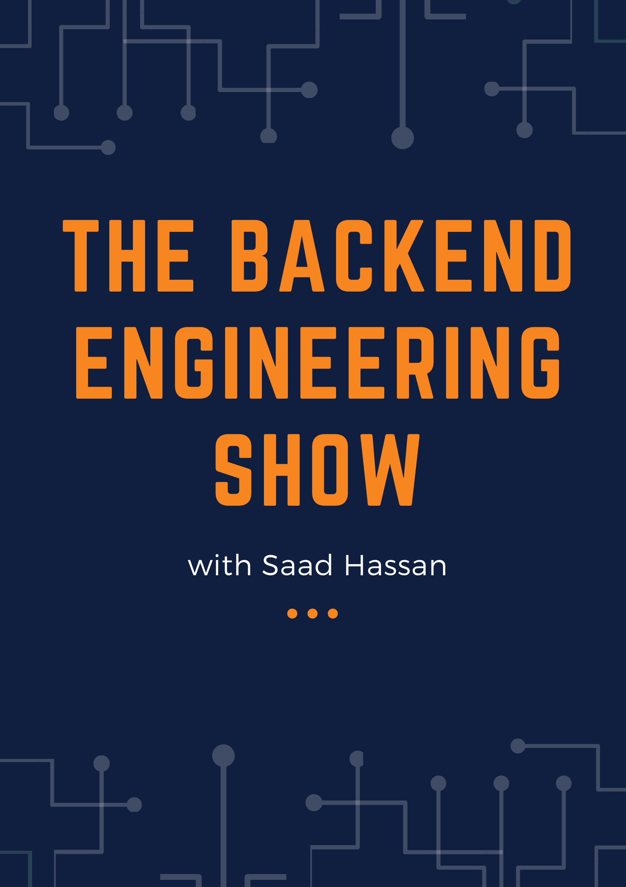

<h1 align="center">Saad Hassan</h1>

  <b>Software Engineer (L4) at Motive</b> 
  Data Platform Engineering &nbsp;·&nbsp; Distributed Systems &nbsp;·&nbsp; AI/ML Infrastructure

  
  
  
  

 

## About

I build the data platforms and distributed systems that analytics and AI applications run on: streaming pipelines, governed data access, metadata infrastructure and cloud-native services. Before moving into data platform engineering I worked on backend systems, serverless APIs and ML inference infrastructure.

## What I Work On

| Data Platform Engineering | AI &amp; Machine Learning | Cloud &amp; Distributed Systems |
| :--- | :--- | :--- |
| Streaming and batch pipelines Change data capture, ETL/ELT Data quality and governance Metadata and data catalog infrastructure | LLM engineering NLP and information retrieval MLOps and model serving Low-latency inference APIs | Kubernetes, containers Infrastructure as code Event-driven architecture CI/CD and observability |

## Selected Impact

- **Data platform modernization:** migrated core data pipelines to a managed streaming architecture across 2 deployment environments, coordinating validation, backfills and cutovers.
- **Multi-region expansion:** extended shared data-platform capabilities across 3 geographic regions and 6 business areas, with regional configuration, encryption and access controls.
- **Access governance:** replaced broad shared permissions with team-scoped, environment-aware access controls across 3 deployment environments.
- **Data quality:** built region-aware quality checks that cut false-positive failures across 2 geographies.
- **Inference performance:** reduced image inference latency from about 3 seconds to about 1 second using AWS Lambda and NVIDIA Triton Inference Server.

## Tech Stack

| Area | Tools |
| :--- | :--- |
| **Data** |      |
| **Languages** |   |
| **Cloud &amp; Infrastructure** |       |
| **Delivery &amp; Observability** |   |

## Experience

| Role | Company | Period | Focus |
| :--- | :--- | :--- | :--- |
| **Software Engineer L4** | Motive | 2025 – Present | Data platform engineering, streaming pipelines, governance, metadata infrastructure |
| **Software Engineer I &amp; II** | Teamo | 2022 – 2025 | Node.js and TypeScript microservices on AWS, serverless APIs, event-driven systems, Terraform |
| **Data Engineer** | Vyro.ai | 2021 – 2022 | ETL pipelines, revenue dashboards, distributed image inference APIs |
| **AI Research Intern (NLP)** | Goddard Discovery | 2021 | Information retrieval, entity embeddings, automated ontology building |

## Teaching &amp; Community

<table>
<tr>
<td valign="top">

I host **The Backend Engineering Show**, a series on designing backend systems at scale and the fundamentals behind them. I have taught more than **2,000 students** across bootcamps in data structures and algorithms, machine learning, NLP and web development.

<b>Bootcamps and open-source learning resources</b>

 

| Resource | Topic |
| :--- | :--- |
| [Deep Learning with TensorFlow](https://github.com/dscuol/Deep-Learning-Course) | Deep learning |
| [Machine Learning Course](https://github.com/dscuol/Machine-Learning-Course) | Machine learning |
| [NLP Bootcamp](https://github.com/dscuol/Natural-Language-Processing-Bootcamp) | Natural language processing |
| [Web Development Bootcamp](https://github.com/dscuol/Web-Development-Bootcamp) | Web development |
| [DSA Bootcamp in C++](https://github.com/saadhaxxan/DSA-Bootcamp-Cpp) | Data structures and algorithms |
| [Awesome Python Projects](https://github.com/saadhaxxan/Awesome-Python-Projects) | Python project ideas |
| [Learn Machine Learning in 5 Months](https://github.com/saadhaxxan/Learn_Machine_Learning_in_5_Months) | Learning roadmap |
| [Learn Data Science in 3 Months](https://github.com/saadhaxxan/Learn-Data-Science-in-3-months) | Learning roadmap |

</td>
<td align="center" valign="top" width="200">

</td>
</tr>
</table>
